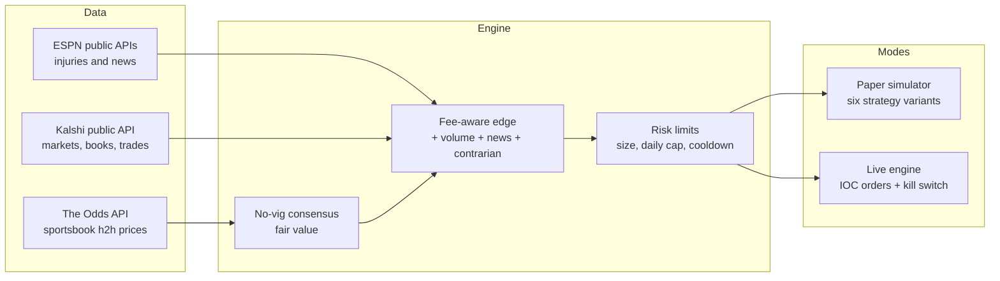

# Kalshi NFL / NBA Sports Trading Bot

A Python trading bot for Kalshi NFL and NBA game-winner markets. It estimates a fair win probability from sportsbook odds, compares that to Kalshi prices after fees, and can buy YES when there is a net edge. Entries can also use ESPN injury/news flags, a contrarian signal against one-sided demand, and a heavy-volume gate.

The default is **paper mode**: the bot logs the trades it would make and tracks simulated P&L. It never places a real order unless you explicitly enable live trading.

This repository is a cleaned, shareable snapshot of the project (source, tests, and config templates only). It does not include account data, logs, or credentials.

## Architecture



- `bot/odds.py` — Odds API client and vig-removed consensus prices.
- `bot/kalshi.py` — Kalshi Trade API v2 client (public market data plus RSA-PSS signed trading calls).
- `bot/signals.py` — volume gate, contrarian demand score, news score, and combined entry score.
- `bot/strategy.py` — matching, fee math, entry/exit rules, and Odds API quota pacing.
- `bot/multi.py` — multi-variant paper simulator (one data pipeline, several portfolios).
- `bot/live.py` — optional live runner with fill-only booking, a kill switch, and a cash floor.
- `bot/espn.py` and `bot/teams.py` — injury/news parsing and NFL/NBA team maps.

## Key features

- **Signed Kalshi requests.** Live calls use RSA-PSS (SHA-256) or Ed25519, depending on the key type. The private key is read from the environment only and is never printed or logged.
- **IOC limit orders with idempotent client order IDs.** An intent is saved before every `POST`. A failed POST is never retried blindly; the bot looks the order up by `client_order_id` and books actual fills.
- **Fee-aware edge.** Kalshi's taker fee is `ceil(0.07 · C · P · (1 − P))`. Net edge subtracts the entry fee, an estimated exit fee, and half the spread.
- **Risk limits.** Configurable max open positions, daily spend cap, re-entry cooldown, balance floor, and a kill-switch file that blocks new orders.
- **Paper simulation.** Six strategy variants share the same market data so you can compare entry and exit rules, including a hold-until-settlement variant and a maker-fill model.
- **Tests.** Offline unit and flow tests mock HTTP. No credentials are required.

## Entry score (defaults in `config.toml`)

```
score (cents) = odds_edge + contrarian + news
  odds_edge  = (sportsbook no-vig fair − Kalshi YES ask) × 100
  contrarian = order-book imbalance + taker-flow imbalance + overpay + drift
  news       = boost when the opponent has worse fresh injury/news than your side
```

Gates include: game volume and 24h volume plus a top-percentile rank, a news block if a key player is ruled out, a price band (0.05–0.95) and max spread, fresh odds, and the risk limits above. Details are in `bot/signals.py`.

## Setup

```bash
cd kalshi-sports-bot
python3 -m venv .venv && source .venv/bin/activate
pip install -r requirements.txt          # requests, cryptography (Python 3.11+)
cp .env.example .env && chmod 600 .env   # add ODDS_API_KEY for paper runs
```

| Variable | Needed for | Notes |
|---|---|---|
| `ODDS_API_KEY` | paper and live signals | Free key at [the-odds-api.com](https://the-odds-api.com) (quota-limited). |
| `KALSHI_API_KEY_ID` | live only | Create an API key in the Kalshi account settings. |
| `KALSHI_PRIVATE_KEY_PATH` or `KALSHI_PRIVATE_KEY` | live only | The PEM downloaded when you create the key. |

The bot loads `.env` automatically and never prints key values.

## Run in paper mode

Paper mode is the default (`dry_run = true` in `config.toml`). These commands do not place orders:

```bash
python3 -m unittest discover -s tests    # offline tests, no credentials
python3 run.py --once                    # one dry-run pass: fair value vs Kalshi
python3 run.py                           # continuous dry-run loop
python3 run_multi.py --once              # one cycle of the six paper variants
python3 run_multi.py                     # continuous paper simulator
python3 report.py [--detail]             # comparison table for the paper variants
```

Override a setting with an environment variable of the same name in caps, for example `EDGE_CENTS=4 python3 run.py`, or edit `config.toml`.

Optional: `python3 -m tests.check_kalshi_markets` hits Kalshi's **public** market endpoints (no auth) to confirm NFL/NBA markets are discoverable. It is not part of the unit test suite.

## Live trading (opt-in, real money)

Live mode is off unless **both** `DRY_RUN=false` and the `--live` flag are set. `python3 run_live.py --live` also refuses to start without `--live`.

Live orders are immediate-or-cancel limits: buys at the evaluated ask, sells at the bid (`reduce_only`). Guardrails include a kill file (`data/live/KILL`), a cash floor (`live_balance_floor_usd`), per-variant position and daily-spend caps, and exchange-position reconciliation every cycle.

Before using real money, try Kalshi's demo environment by pointing `KALSHI_BASE_URL` and `KALSHI_TRADE_BASE_URL` at the demo hosts with a demo key. Prediction-market trading is risky; you can lose the money you put in.

## Tech stack

- Python 3.11+
- `requests` for HTTP
- `cryptography` for RSA-PSS / Ed25519 request signing
- The Odds API, Kalshi Trade API v2, and ESPN's public (keyless) sports endpoints
- `unittest` for the offline test suite

## Disclaimer

This is an educational / portfolio project, not financial advice and not a promise of profit. Paper results do not predict live results. Fees, slippage, stale odds, and API limits all matter. Use at your own risk, and never commit real API keys or private keys to git.
